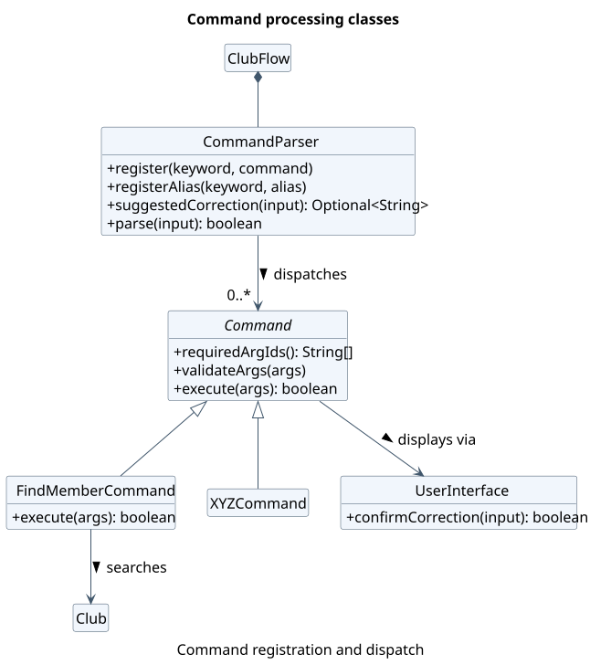
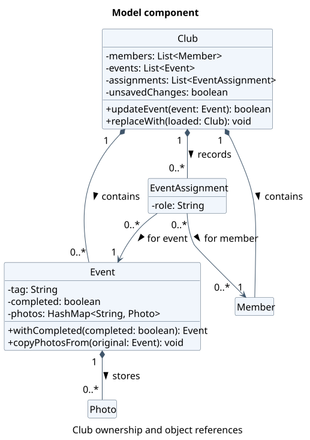
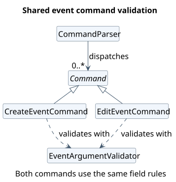
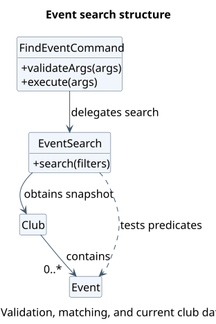

# Developer Guide

ClubFlow is a Java command-line application for helping student clubs manage
events, members, and related information. This guide describes the current implementation;
command examples are also available in the [User Guide](UserGuide.md).

## Contents

* [Acknowledgements](#acknowledgements)
* [Setting up, getting started](#setting-up-getting-started)
* [Design](#design)
* [Implementation](#implementation)
* [Documentation, logging, testing, dev-ops](#documentation-logging-testing-dev-ops)
* [Appendix A: Product Scope](#appendix-a-product-scope)
* [Appendix B: User Stories](#appendix-b-user-stories)
* [Appendix C: Non-Functional Requirements](#appendix-c-non-functional-requirements)
* [Appendix D: Glossary](#appendix-d-glossary)
* [Appendix E: Instructions for Manual Testing](#appendix-e-instructions-for-manual-testing)

## Acknowledgements

* [CS2113 Java project template](https://github.com/NUS-CS2113-AY2627-S1/tp):
  provided the initial project structure, Gradle wrapper, build and CI configuration,
  Checkstyle configuration, and documentation templates, which were adapted for ClubFlow.
* [AddressBook Level 3 Developer Guide](https://se-education.org/addressbook-level3/DeveloperGuide.html):
  provided the organisational structure adapted for this guide, including design,
  implementation, requirements, and manual testing sections.
* [SE-EDU Java coding standard](https://se-education.org/guides/conventions/java/basic.html):
  provides the coding conventions enforced by the project's Checkstyle configuration.
* [JUnit](https://github.com/junit-team/junit-framework): the project uses JUnit 5's
  Jupiter API and engine, together with the JUnit Platform launcher, for automated tests.
* [Gradle](https://gradle.org/): used for build automation and dependency management.
* [Shadow Gradle plugin](https://gradleup.com/shadow/): used to package the application
  as an executable JAR.
* [Checkstyle](https://checkstyle.org/): used to check Java source and test code
  against the configured coding conventions.
* [PlantUML](https://plantuml.com/): used to generate UML diagrams from textual sources.
* [Checkout](https://github.com/actions/checkout),
  [Setup Java](https://github.com/actions/setup-java), and
  [Gradle Wrapper Validation](https://github.com/gradle/actions/tree/main/wrapper-validation):
  reusable GitHub Actions used to check out the repository, provision Java, and validate
  the Gradle wrapper in CI.
* [ChatGPT](https://chatgpt.com/): assisted with event feature implementation,
  edge-case identification and JUnit test generation for event and photo management,
  drafting and reviewing User Guide and Developer Guide documentation (including
  manual testing instructions for import, invalid save files, and autosave recovery),
  and PlantUML diagram sources.

## Setting up, getting started

Use JDK **25**, Git, and an IDE with Gradle support. Import the repository as a
Gradle project and select JDK 25 for both the project SDK and the Gradle JVM.
Run commands below from the repository root. On Windows, use PowerShell:

```powershell
java -version
.\gradlew.bat run
```

`run` compiles and starts ClubFlow with assertions enabled to check internal
assumptions. On macOS or Linux, replace `.\gradlew.bat` with `./gradlew`.
Alternatively, run `clubflow.ClubFlow.main()` in the IDE with `-ea` enabled.

To build the packaged application:

```powershell
.\gradlew.bat shadowJar
java -ea -jar build/libs/clubflow.jar
```

Paths such as `saves/`, `cache/`, and `clubflow.log` are relative to the process's
working directory. Launch from a separate folder for manual testing to avoid
changing development data.

## Design

### Architecture

The following diagram illustrates ClubFlow's main architectural responsibilities and their dependencies.

<a href="diagrams/architecture/Architecture.svg"></a>

[PlantUML source](diagrams/architecture/Architecture.puml).

These responsibilities are logical groupings rather than separate modules or component interfaces. Most core classes belong to the `clubflow` package.

| Responsibility           | Main classes                                                                 | Purpose                                                                                   |
|--------------------------|------------------------------------------------------------------------------|-------------------------------------------------------------------------------------------|
| Application coordination | `ClubFlow`                                                                   | Initialises the application, coordinates commands, handles errors, and triggers autosave. |
| User interaction         | `UserInterface`                                                              | Handles terminal input, output, and user confirmations.                                   |
| Command processing       | `CommandParser`, `Command`, concrete commands, search and completion helpers | Parses and validates input, dispatches commands, and executes requests.                   |
| Club data                | `Club`, `Event`, `Member`, `EventAssignment`, `Photo`                        | Manages club data and maintains relationships between objects.                            |
| Storage                  | `ClubManager`, `SaveLoadManager`                                             | Manages club files, data persistence, legacy migration, and photo synchronisation.        |

`ClubFlow` creates a shared `Club`, `UserInterface`, `CommandParser`, and `ClubManager` at startup. Command objects are registered once with the parser and receive their required dependencies through their constructors.

After `ClubManager.initialize()` loads the default club, the application enters its input loop. Each iteration reads user input, handles optional command correction, and delegates execution to `CommandParser.parse()`. Following successful parsing, `ClubFlow` attempts to save the active club if it has unsaved changes, then checks whether the command requested application exit.

`Event` and `Photo` interact directly with the filesystem for photo operations. The Storage component separately manages persistent club records and saved photo directories.

### UI component

ClubFlow uses a terminal interface implemented by [`UserInterface`](../src/main/java/clubflow/UserInterface.java), which handles user input and output without modifying club data.

`ClubFlow` creates a single `UserInterface` instance, shared with `CommandParser` and the registered commands. Its main responsibilities are:

- **Input:** `welcome()` displays the startup message, while `prompt()` reads commands using a `Scanner` over `System.in`. The interface also handles confirmation of suggested command corrections.
- **Output:** `print()` displays messages with the `[CF]` prefix and supports indentation. `printWithoutPrefix()` is used for copyable content, such as event invitations.
- **Error messages:** `ClubFlow` displays expected command exceptions through the UI, including command syntax when appropriate, while unexpected runtime exceptions are logged.

The class diagram illustrates how `ClubFlow`, `CommandParser`, and commands interact with the shared `UserInterface` instance.

<a href="diagrams/architecture/UiClassDiagram.svg"></a>

[PlantUML source](diagrams/architecture/UiClassDiagram.puml).

**Design consideration:** Centralising input and output ensures consistent terminal formatting. However, commands print directly through `UserInterface` rather than returning presentation-independent results. Replacing the terminal with a GUI would therefore require changes to command execution or an adapter. Integration tests also need to redirect `System.in` and capture `System.out`.

### Logic component

Main entry point: [CommandParser.java](../src/main/java/clubflow/command/CommandParser.java).

`ClubFlow` creates and registers command objects with `CommandParser` at startup. Each command keyword and its aliases refer to the same instance, avoiding the need to recreate commands for every input.

The following class diagram illustrates command registration, dispatch, and execution. `XYZCommand` represents the concrete commands omitted from the diagram.

<a href="diagrams/architecture/LogicClass.svg"></a>

[PlantUML source](diagrams/architecture/LogicClass.puml).

#### Command processing

The Logic component processes input as follows:

1. **Command correction:** `suggestedCorrection(input)` checks unknown command keywords of at least four characters. It may suggest a uniquely closest keyword within one or two character edits, depending on word length, while preserving the arguments. `UserInterface.confirmCorrection()` allows the user to accept or cancel the suggestion.
2. **Argument parsing:** `CommandParser.parse(input)` identifies the command, preserves quoted arguments, and checks supplied argument IDs against the command's required, optional, flag, and repeatable arguments.
3. **Validation and execution:** The selected command applies feature-specific validation through `validateArgs()` before running `execute()`. The returned boolean indicates whether the application should exit, rather than whether execution succeeded.

Invalid commands or arguments raise `CommandParseException`, which `ClubFlow` handles by displaying the error and, when

### Model component

The Model component manages the active club's data through `Club`, `Event`, `Member`, `EventAssignment`, and `Photo`.

The class diagram shows how `Club` maintains events, members, and assignments. Each `EventAssignment` references an `Event` and a `Member`, while each `Event` manages its associated photos.

<a href="diagrams/architecture/ModelClassDiagram.svg"></a>

[PlantUML source](diagrams/architecture/ModelClassDiagram.puml).

#### Data management

`Club` stores members, events, and assignments in private lists. Its getters return read-only snapshots using `List.copyOf()`, preventing direct modification of the collections.

Events have unique, case-insensitive tags within a club, while members are identified by one-based list indices. `EventAssignment` stores references to the actual `Event` and `Member` objects rather than their indices, ensuring assignments remain valid when other members are removed.

#### Maintaining data consistency

When an event is edited, `Club.updateEvent()` replaces the original `Event` while preserving its position and photos. It also recreates affected `EventAssignment` objects to reference the replacement.

Similarly, `Club.replaceMemberByIndex()` transfers assignments to the replacement member. Deleting an event or member removes its associated assignments to prevent stale references.

#### Shared state and persistence

Commands share a single `Club` instance. When switching clubs, `ClubManager` loads the selected data and calls `Club.replaceWith()` to update the existing object rather than replacing its reference. This allows registered commands to continue accessing the active club without reconstruction.

`Club` tracks modifications using an `unsavedChanges` flag. Mutating operations set it to `true`, while `ClubManager` calls `markSaved()` after successful persistence. This avoids unnecessary saves after read-only commands.

### Storage component

Storage connects the shared in-memory `Club` to local files. Its main classes are
[`SaveLoadManager`](../src/main/java/clubflow/SaveLoadManager.java) and
[`ClubManager`](../src/main/java/clubflow/ClubManager.java).

| Class | Responsibility |
| --- | --- |
| `SaveLoadManager` | Serialises club records, validates and reconstructs loaded data, and synchronises photo directories. |
| `ClubManager` | Selects each club's save path, initialises the default club, migrates legacy data, and coordinates saving and switching clubs. |
| `LoadCommand` | Imports a user-selected file into the active club without changing the active club ID. |

`ClubFlow` triggers automatic saving through `ClubManager`, while `LoadCommand`
uses `SaveLoadManager` to read an import. Loaded records are assembled in a
separate `Club` before `replaceWith()` updates the shared model. Keeping the
shared object allows existing commands to continue using the newly loaded data.

Each club's records are stored at `saves/clubs/<club-id>/club.cf`, with saved
photos in the adjacent `photos/` directory. Relative paths are resolved from the
application's working directory. Storage reports I/O failures to its callers;
the application or command displays the corresponding message through the UI.
See [Autosave, import, and file format](#autosave-import-and-file-format) for the
record format and [Photo persistence](#photo-persistence) for photo handling.

### Common classes

Shared command infrastructure and utilities are located in `clubflow.command`, while application exceptions are grouped under `clubflow.exception`.

#### Command contract

[`Command`](../src/main/java/clubflow/command/Command.java) provides the common interface for command execution. Commands declare their accepted arguments for parser validation and define syntax strings for the help system. Both must remain consistent when modifying a command.

Feature-specific commands are organised under `clubflow.command.event`, `.member`, `.club`, and `.photo`. The parent package contains the parser, base command class, shared argument identifiers, and general commands such as help, exit, load, and completion dispatch.

`CommandParser` validates argument structure before delegating feature-specific rules to each command's `validateArgs()`. The boolean returned by `execute()` indicates whether the application should exit, not whether data was modified. Autosave instead depends on the shared `Club` object's unsaved flag.

#### Shared event validation

[`EventArgumentIds`](../src/main/java/clubflow/command/EventArgumentIds.java) defines shared argument identifiers, while [`EventArgumentValidator`](../src/main/java/clubflow/command/event/EventArgumentValidator.java) centralises validation for event creation and editing.

The validator checks supplied event fields before mutation, including rejecting the `|` character reserved for the save format. This ensures that both commands enforce consistent input rules.

Event search has different requirements, such as not requiring an event tag, so its filter validation remains in `FindEventCommand`.

The following class diagram shows how event creation and editing reuse the shared validator.

<a href="diagrams/common/EventValidationClass.svg"></a>

[PlantUML source](diagrams/common/EventValidationClass.puml).

#### Error handling

ClubFlow distinguishes expected application failures from programming errors:

- [`ClubFlowException`](../src/main/java/clubflow/exception/ClubFlowException.java) is the checked base exception for expected failures. These propagate to the input loop, where their messages are displayed.
- [`CommandParseException`](../src/main/java/clubflow/exception/CommandParseException.java) represents invalid command input. The parser associates it with the selected command so that the appropriate syntax can also be displayed.
- [`EventNotFoundException`](../src/main/java/clubflow/exception/EventNotFoundException.java) and [`DuplicateEventException`](../src/main/java/clubflow/exception/DuplicateEventException.java) distinguish event lookup failures from duplicate tags.

Programming-contract violations, such as invalid command registration, use unchecked exceptions. Unexpected runtime exceptions are caught and logged by `ClubFlow` at the input-loop boundary.

Expected exceptions should be propagated rather than printed and rethrown, avoiding duplicate error messages.

## Implementation

This section describes noteworthy details of selected implemented features.

### Event management

Use the following entry points when changing event behavior. Command syntax and
user-visible rules belong in the [User Guide](UserGuide.md).

| Feature | Start here |
| --- | --- |
| Create | [CreateEventCommand](../src/main/java/clubflow/command/event/CreateEventCommand.java) |
| Delete | [DeleteEventCommand](../src/main/java/clubflow/command/event/DeleteEventCommand.java) |
| View | [ViewEventCommand](../src/main/java/clubflow/command/event/ViewEventCommand.java) |
| Edit | [EditEventCommand](../src/main/java/clubflow/command/event/EditEventCommand.java) |
| Find | [FindEventCommand](../src/main/java/clubflow/command/event/FindEventCommand.java), [EventSearch](../src/main/java/clubflow/search/EventSearch.java) |
| Completed/pending | [CompletionCommand](../src/main/java/clubflow/command/CompletionCommand.java), [EventCompletion](../src/main/java/clubflow/completion/EventCompletion.java) |

Commands share a long-lived [Club](../src/main/java/clubflow/Club.java). Look up
events on each request: retaining an event reference across requests can leave
a command using an old object after editing, marking, or loading data. Route
mutations through the club so relationship maintenance and autosave stay coordinated.

Deleting an event also removes its member assignments, so deletion changes both
the event list and the assignment roster.

The creation flow below ends before the input loop's autosave step.

<a href="diagrams/events/CreateEventSequence.svg"></a>

[PlantUML source](diagrams/events/CreateEventSequence.puml).

#### Editing and replacement

Edits validate a replacement before installing it, avoiding partially applied
changes. The tradeoff is that replacing an event must preserve its position,
photos, and member assignments; this belongs in `Club.updateEvent()`.
When adding an event field, review both editing and completion copy paths,
the displayed/searchable details, and the save/load format together.

<a href="diagrams/events/EditEventSequence.svg"></a>

[PlantUML source](diagrams/events/EditEventSequence.puml).
The sequence expands the operations previously hidden in reference frames.
`Club.updateEvent()` preserves the existing event position and rebinds affected
assignments after the replacement has been created. Autosave follows this flow;
the club is marked saved only after persistence succeeds.

An earlier list returned by `getEvents()` still references the previous event;
the club's current list references the replacement instead.

<a href="diagrams/events/EventReplacementObject.svg"></a>

[PlantUML source](diagrams/events/EventReplacementObject.puml).

This object diagram highlights why callers must obtain a new event snapshot after
an edit: the shared `Club` points to the updated event, but an earlier snapshot
still points to the previous object.

#### Search

Search combines predicates over the current event snapshot. A linear scan keeps
ordering predictable and avoids maintaining indexes as events change. Keep
filter validation in `FindEventCommand` and matching in `EventSearch`; compile
filter values once per request. Consider indexing only if measured usage justifies
the additional update logic.

<a href="diagrams/events/EventSearchClass.svg"></a>

[PlantUML source](diagrams/events/EventSearchClass.puml).

<a href="diagrams/events/FindEventSequence.svg"></a>

[PlantUML source](diagrams/events/FindEventSequence.puml).

The sequence shows predicate construction and filtering directly rather than
pointing to interactions not provided as separate diagrams.

#### Completion

Mark and unmark share dispatch logic, with the desired state configured at
registration. The event handler owns lookup and replacement, keeping the command
independent of event details. Preserve idempotency: repeating a request must keep
the requested state, not toggle it. Completion uses the same replacement path as
editing, so both features must preserve unrelated data.

Both commands share a method-reference handler bound to the same
`EventCompletion` object. Their only difference is the desired completion state.

In the sequence diagram, `completed` is `True` for `mark` and `False` for `unmark`.

<a href="diagrams/events/CompletionSequence.svg"></a>

[PlantUML source](diagrams/events/CompletionSequence.puml).

#### Event invitations

`InviteCommand` implements `invite e/TAG`. It looks up the event in the active
club and formats its name, date, and venue as a copyable text invitation.
Missing optional details become visible placeholders so the organiser can
complete the message before sharing it. `UserInterface.printWithoutPrefix(...)`
prints the invitation block without the usual `[CF]` prefix on every line.
This command only reads event data; an unknown tag raises
`EventNotFoundException` and produces no invitation. The invitation is for an
event and contains text only; it does not attach event photos or send messages.

### Searching members

`FindMemberCommand` searches the current `Club.getMembers()` snapshot on every
request. It does not retain a result list, so a later edit, deletion, or club
switch is reflected in the next search. Results carry the member's **current
one-based index**, which can then be used by `editMember`, `assignMember`, or
`deleteMember`. A deletion can change later indices; clients must obtain a fresh
index before acting again.

The parser accepts repeated `q/` and `f/` arguments. `Command.getArgumentValues(...)`
recovers their separate values, and `searchMember(...)` requires **every** supplied
filter to match. For `q/`, the command takes the best match across name, Telegram,
email, and functions; `n/`, `t/`, `e/`, and `f/` restrict matching to their named
fields. Matching ignores case and surrounding whitespace. The command also
accepts a leading `@` in Telegram searches.

Direct matches receive scores of 300 for exact, 200 for prefix, and 100 for
substring matches. Scores from multiple filters are added; ties keep member-list
order through the stored index. If a name or Telegram handle has no direct match,
a four- or five-character query may have one spelling edit, while a query of six
to 64 characters may have two. The bounded edit-distance calculation compares
whole names and individual name words; email and functions remain strict.
Members requiring any spelling tolerance appear under **Possible matches**,
separate from direct results, with at most five suggestions shown.

This design favors understandable, current results over a search index that would
have to be maintained after every edit and club switch. Possible matches are
never selected automatically: the user checks the displayed contact details and
index before issuing a command that changes data.

### Switching clubs without rebuilding commands

ClubFlow supports multiple clubs, while keeping the same parser, command
objects, and in-memory [`Club`](../src/main/java/clubflow/Club.java) instance.
This is important because event and member commands receive their `Club` in
their constructors at startup. Replacing the `Club` *reference* on a switch
would leave those commands pointing at the previous club's data.

The relevant classes are
[`ClubManager`](../src/main/java/clubflow/ClubManager.java),
[`CreateClubCommand`](../src/main/java/clubflow/command/club/CreateClubCommand.java),
[`SwitchClubCommand`](../src/main/java/clubflow/command/club/SwitchClubCommand.java),
[`ListClubsCommand`](../src/main/java/clubflow/command/club/ListClubsCommand.java), and
[`CurrentClubCommand`](../src/main/java/clubflow/command/club/CurrentClubCommand.java).

**Club creation and selection:**

1. A club ID is validated as letters, digits, `_` or `-` and normalised to
   lowercase using `Locale.ROOT`. `default` is reserved. Club IDs are used
   as directory names, so separators and parent-directory traversal are rejected.
2. `createClub` creates an initially empty `club.cf` file in
   `saves/clubs/<club-id>/`. It does **not** change the active club.
3. `listClubs` lists club directories containing a `club.cf` file; the default
   club is first, followed by other IDs in case-insensitive sorted order.
   `currentClub` reads the active ID from `ClubManager`.
4. The application starts in `default` on every launch. The last selected
   non-default club is **not** restored as the active club at the next launch.

**Switching:** `SwitchClubCommand.execute(...)` delegates to
`ClubManager.switchClub(targetId)`. The manager checks that the target file
exists and, unless it is already active, calls `saveActiveClub()` before
loading the target data with `SaveLoadManager.load(...)` into a temporary
`Club`. Only after the load succeeds does it call
`activeClub.replaceWith(loaded)` and change `activeClubId`. `replaceWith`
replaces the shared object's member, event, and assignment collections instead
of replacing the shared object itself. The unsaved flag is then cleared.
`SaveLoadManager` also saves the current club's photos to its own directory and
loads the target club's photos into the working cache.

<a href="diagrams/clubs/SwitchClubSequence.svg"></a>

[PlantUML source](diagrams/clubs/SwitchClubSequence.puml).

**Failure handling:** an unknown club raises `ClubNotFoundException`. Failure
to save or load displays an I/O error; the active ID is not changed. A
malformed target save file is rejected before the in-memory club is replaced.
A request to switch to the already active club is a no-op. A successful
switch does not invoke the input loop's normal dirty-data autosave because
the loaded club is marked saved.

**Design alternatives:** rebuilding all commands on every switch would avoid
shared mutable state, but requires rebuilding registrations and ensuring no
command retains stale dependencies. Using one shared `Club` with
`replaceWith(...)` keeps registrations stable and preserves existing
command constructors. The tradeoff is that commands and other collaborators
must not cache references to individual `Event` or `Member` instances across
switches. It also means only one club is loaded into the shared model at a
time.

### Autosave, import, and file format

#### Automatic saving and startup loading

Mutating operations on `Club` set its `unsavedChanges` flag. After
`CommandParser.parse()` returns normally, `ClubFlow.run()` checks this flag and
calls `ClubManager.saveActiveClub()` when needed. The manager delegates to
`SaveLoadManager.save()` and calls `markSaved()` only after saving records and
photos succeeds. The command's return value controls termination, not saving;
the save attempt occurs before handling an `exit` request.

If saving throws `IOException`, the application logs the failure, displays
`Changes could not be saved:`, and retains the modified in-memory data and
unsaved flag. A later normally processed command retries saving, including a
read-only command or `exit`. An invalid command or cancelled correction does
not reach this save step. Exiting after another failed save still terminates
the application, so changes that were never saved can be lost.

At startup, `ClubManager.initialize()` loads `default`. It first migrates the
legacy `saves/clubs.cf` file and its photos when the new default save is absent;
otherwise, a missing default save is created as an empty file. An unreadable or
invalid startup save causes `ClubFlow` to report the error and stop before the
command loop, rather than overwrite it with empty data.

#### Importing a saved club

[`LoadCommand`](../src/main/java/clubflow/command/LoadCommand.java) implements
`load p/PATH`. Validation requires a non-blank, syntactically valid relative
path. `SaveLoadManager.load()` reads UTF-8 records into a temporary `Club`,
checks the records and relationships, and restores photos from a `photos/`
directory beside the source file. Assignments are resolved after members and
events have been read.

Only after loading returns successfully does the command call
`club.replaceWith(loaded)`. This replaces the current records rather than
merging them, retains the active club ID, and marks the shared data as unsaved.
The input loop then attempts to save the imported data to the active club's
normal location. Importing does not select the source file as a new autosave
destination; when it differs from the active save file, it is left unchanged.

An I/O or record-validation failure displays `Data not loaded!` and leaves the
current in-memory records in place. Invalid records include a line number in
their error message. Photo-cache operations involve separate filesystem changes;
the import is not a transaction covering both records and every photo operation.

#### Text record format

`SaveLoadManager.save()` creates parent directories as needed and replaces the
UTF-8 text file. It writes members first, then events, then assignments, with
one record per line:

```text
MEMBER|NAME|TELEGRAM|EMAIL|FUNCTIONS
EVENT|TAG|NAME|DATE|DEADLINE|BUDGET|VENUE|LOGISTICS|COMPLETED
ASSIGNMENT|EVENT_TAG|MEMBER_INDEX|ROLE
```

* `|` separates fields. The parser preserves empty trailing fields using
  `split("\\|", -1)`. There is no field-escaping mechanism, so member and event
  input rejects `|`; assignment roles also reject it and line breaks.
* A member record has five fields. At least one contact is required. Functions
  are comma-separated; an empty field means no functions. Individual function
  names cannot be blank or contain commas.
* An event record has nine fields. Dates use `YYYY-MM-DD`, with the literal
  `null` for an unset date or deadline. Budgets must be finite and non-negative;
  completion is exactly `true` or `false`. Tags must be non-blank and unique
  within the loaded club, ignoring case. Optional text can be empty.
* Older eight-field event records omit completion and load as not completed.
  Saving writes the current nine-field format.
* An assignment record has four fields. Its member index is one-based in the
  saved member order, and its event tag must identify an existing event.
  The role may be empty. Invalid references and duplicate assignments are rejected.
* Unknown record types and incorrect field counts are rejected. An empty file
  represents an empty club; blank lines are not ignored.

For example, these records restore Alice, a completed event, and her event role:

```text
MEMBER|Alice|alice||Logistics
EVENT|CAMP|Welcome Camp|2026-12-25|null|100.0|Main Hall||true
ASSIGNMENT|CAMP|1|Lead Host
```

#### Design considerations and limits

A readable text format avoids a database dependency and makes small saves easy
to inspect. Its tradeoff is the delimiter restrictions and the need to update
serialization, validation, and compatibility handling together when adding fields.
The unsaved flag avoids rewriting data after every read-only command while
allowing retries after a failed save.

The text file is written directly with `Files.write()`, without an atomic
temporary-file replacement. A failed write may therefore leave a partial file.
Photos are synchronised after the text write, so a photo failure can occur after
records have already been saved. The unsaved flag remains set in that case,
but records and photos are not committed as one atomic operation. The
[manual tests](#import-and-invalid-save-files) cover rejected imports and startup
failures; [autosave recovery tests](#autosave-failure-and-recovery) cover retries.

### Photo lifecycle and persistence limits

ClubFlow supports importing, listing, opening, and deleting event photos. Photo commands operate through the shared `Club`, which delegates operations to the relevant `Event`. The [`Photo`](../src/main/java/clubflow/photo/Photo.java) class handles file operations, while [`SaveLoadManager`](../src/main/java/clubflow/SaveLoadManager.java) manages photo persistence.

| Feature | Main classes |
| --- | --- |
| Import | [`AddPhotoCommand`](../src/main/java/clubflow/command/photo/AddPhotoCommand.java), [`AddAllPhotoCommand`](../src/main/java/clubflow/command/photo/AddAllPhotoCommand.java) |
| List, open, delete | [`ListPhotoCommand`](../src/main/java/clubflow/command/photo/ListPhotoCommand.java), [`OpenPhotoCommand`](../src/main/java/clubflow/command/photo/OpenPhotoCommand.java), [`DeletePhotoCommand`](../src/main/java/clubflow/command/photo/DeletePhotoCommand.java) |
| Photo management | [`Event`](../src/main/java/clubflow/event/Event.java), [`Photo`](../src/main/java/clubflow/photo/Photo.java) |

#### Photo importing

Photos are stored under `cache/photos/<event-tag>/`. Each `Event` maintains a `HashMap<String, Photo>` that associates photo names with their corresponding objects.

The following sequence diagram illustrates a successful single-photo import, including argument validation, event lookup, image conversion, and photo registration.

<a href="diagrams/photos/PhotoImportSequence.svg"></a>

[PlantUML source](diagrams/photos/PhotoImportSequence.puml).

`AddPhotoCommand` validates the arguments before delegating to `Club.addPhoto()`. After locating the event, `Event.addPhoto()` constructs a `Photo` object, which validates the source and destination, reads the image, and saves it as PNG. The event registers the photo, and the club marks its data as unsaved.

If no name is provided, the source filename without its extension is used. Duplicate destination filenames are rejected to prevent overwriting existing photos.

Bulk importing uses `AddAllPhotoCommand` and `Event.addPhotos()`. Each regular file is processed independently, allowing valid photos to be imported even when others fail. Successes and failures are counted.

#### Photo management

`Event` provides methods for listing, opening, and deleting registered photos. Opening uses the operating system's default image viewer or file explorer. Deletion removes the physical file before removing its registration, while bulk deletion records successful and failed operations.

#### Photo persistence

`SaveLoadManager` stores photos separately from the text-based club records.

When saving, `savePhotos()` copies photos from the working cache into the active club's save directory. When loading, `loadPhotos()` restores the saved photos into the cache and reconstructs their `Photo` objects.

Photo-directory replacement uses a temporary staging directory and a backup of the previous destination. If installing the staged directory fails, the previous directory can be restored.

This separation allows photos to persist across restarts and club switches but introduces consistency limitations.

#### Error handling and limitations

Invalid photo names, missing files, unsupported images, duplicate filenames, and file-operation failures are reported through photo-specific exceptions.

Key limitations include:

- All imported images are converted to PNG.
- Opening images depends on operating system desktop support.
- Bulk imports may partially succeed.
- Club records and photos are persisted separately, so photo synchronisation may fail after the text save succeeds.
- Deleting an event does not immediately remove its photo directory. Obsolete directories are excluded during the next successful photo synchronisation.

## Documentation, logging, testing, dev-ops

### Documentation

The [User Guide](UserGuide.md) documents command syntax and user-visible behaviour, while this Developer Guide focuses on architecture, implementation, and testing. Developers should update the relevant documentation and diagrams when modifying features.

UML diagrams are generated from PlantUML (`.puml`) sources under [`docs/diagrams`](diagrams/). Each source is stored alongside its generated SVG, with shared styling defined in [`UmlStyle.iuml`](diagrams/shared/UmlStyle.iuml). See the [diagram maintenance instructions](diagrams/README.md) for regeneration details.

### Logging

[`ClubFlow.configureLogging()`](../src/main/java/clubflow/ClubFlow.java) configures Java's `java.util.logging` framework. Log records are appended to `clubflow.log` in the working directory using `SimpleFormatter`. Parent console handlers are disabled to prevent diagnostic messages from interfering with terminal output.

ClubFlow uses the following logging levels:

| Level     | Usage                                                                |
|-----------|----------------------------------------------------------------------|
| `INFO`    | Application lifecycle and save/load operations                       |
| `FINE`    | Command registration, execution, data changes, and expected failures |
| `WARNING` | Storage and photo I/O failures                                       |
| `SEVERE`  | Unexpected runtime failures                                          |

Classes use `Logger.getLogger(MyClass.class.getName())` and inherit the configured logging hierarchy. `FINE` messages require the logger and handler levels to permit them.

If the log file cannot be opened, package logging is disabled without preventing application startup. Log files are excluded from version control.

### Automated testing and style checks

ClubFlow uses JUnit 5 through Gradle, with tests located under [`src/test/java/clubflow/`](../src/test/java/clubflow). Assertions are enabled in `build.gradle` during test execution.

Tests cover three main areas:

- **Command and parser tests:** [`ClubCommandsTest`](../src/test/java/clubflow/command/ClubCommandsTest.java) verifies command syntax, invalid or duplicate club IDs, active-club output, and error handling. Other command tests cover event and member operations.
- **Model and storage tests:** [`ClubManagerTest`](../src/test/java/clubflow/ClubManagerTest.java) covers club creation, switching, persistence, and legacy migration. [`MultiClubPhotoStorageTest`](../src/test/java/clubflow/MultiClubPhotoStorageTest.java) verifies photo isolation between clubs.
- **Input-loop integration tests:** [`ClubFlowMultiClubTest`](../src/test/java/clubflow/ClubFlowMultiClubTest.java) simulates user commands and application restarts to verify persistence and separation between clubs.

Filesystem tests use JUnit's `@TempDir` to isolate test data. Input-loop tests redirect `System.in` and `System.out` to simulate interaction and check command output, restoring the original streams afterward.

To run all tests and Checkstyle checks from the repository root:

```powershell
.\gradlew.bat test
.\gradlew.bat check
```

To run the multiple-club regression tests separately:

```powershell
.\gradlew.bat test --tests clubflow.ClubManagerTest --tests clubflow.ClubFlowMultiClubTest --tests clubflow.command.ClubCommandsTest
```

On macOS or Linux, replace `.\gradlew.bat` with `./gradlew`.

Automated tests are complemented by the [manual testing instructions](#appendix-e-instructions-for-manual-testing), particularly for terminal behaviour, photo viewers, filesystem permissions, and release packaging.

### Extending commands

ClubFlow uses an extensible command system based on the abstract `Command` class and `CommandParser`. New commands can be added without modifying the parser's core logic.

#### Adding a new command

To implement a command, create a subclass of `Command` and pass the shared `UserInterface` to its constructor.

Each command must:

1. Declare its accepted arguments through `requiredArgIds()` and `optionalArgIds()`. Commands can also override `flagArgIds()` and `repeatableArgIds()` when needed.
2. Implement `execute()` to perform the requested operation.
3. Override `validateArgs()` for command-specific validation.
4. Register itself in `ClubFlow` using `CommandParser.register()`.

`CommandParser` validates argument structure, including required, unsupported, and duplicate arguments, before command execution. Feature-specific rules remain within individual commands or their validators.

#### Command syntax and aliases

Each command defines its help syntax through `addSyntax()`. Multiple calls can specify alternative command formats, which are retrieved by `getSyntaxes()` for the help system.

For example, `AddPhotoCommand` defines:

```java
addSyntax("e/Tag [n/Name] p/Path");
```

Commands can also register aliases:

```java
parser.register("addPhoto", new AddPhotoCommand(ui, club));
parser.registerAlias("addPhoto", "ap");
```

Both `addphoto` and `ap` invoke the same command instance. Keywords are case-insensitive, and duplicate registrations are rejected.

#### Testing new commands

New commands should be tested for successful execution, missing or invalid arguments, duplicate arguments, and command-specific validation failures.

Developers should also update the command's help syntax, relevant automated tests, and User Guide documentation to reflect any changes in behaviour.

## Appendix A: Product Scope

### Target user profile

Student club organisers and committee members who:

- Need to manage club events, members, and event responsibilities.
- Organise multiple events or manage multiple clubs.
- Prefer a keyboard-driven application over a graphical interface.
- Are comfortable using command-line applications.
- Need to store and retrieve club information across sessions.

### Value proposition

ClubFlow gives organisers of student clubs a single, lightweight command-line
workspace for the information needed to run their activities:

* **Centralised event planning:** event dates, deadlines, budgets, venues,
  logistics, and completion state are recorded alongside member assignments.
* **Less repetitive administration:** organisers can look up events or members,
  update details through commands, and have changes saved without running a
  separate save command.
* **Separate clubs on one installation:** organisers helping more than one club
  can create and switch between independent club records. Reusing the same
  event tag in different clubs does not cause a conflict.
* **Event photo organisation:** photos are associated with events and saved
  with the owning club's data for later use.

The product is intended for local, offline record-keeping. It does not provide
shared live editing, cloud synchronisation, or automatic event notifications;
organisers coordinating across devices must transfer their files themselves.

## Appendix B: User Stories

These MVP stories are based on the team's brainstorming list. Overlapping ideas
about editing events and saving data have been combined. The stories below
describe features available in the current implementation.

Priorities: High (must have) - `* * *`, Medium (nice to have) - `* *`, Low
(unlikely to have) - `*`.

| Priority | As a ... | I want to ... | So that I can ... |
| --- | --- | --- | --- |
| `* * *` | interest group head | create an event with its name, date, venue, deadline, budget, and logistics | give the team a shared plan for its work |
| `* * *` | club organiser | view all events or one event's details and budget | check plans before changing them |
| `* * *` | event organiser | edit an event's date, deadline, budget, venue, logistics, or name | keep its record accurate when plans change |
| `* * *` | club organiser | delete an outdated event | remove plans that are no longer relevant |
| `* * *` | club manager | add and view members with their contact details and functions | keep an up-to-date membership record |
| `* * *` | club manager | edit a member's details | keep contact information and functions accurate |
| `* * *` | club manager | delete a former member | keep the roster current |
| `* * *` | event organiser | assign or unassign members and record their event roles | see who is responsible for an event |
| `* * *` | regular user | have club data load and save automatically | resume work after restarting without saving each change manually |
| `* * *` | first-time user | see available commands and the syntax of a chosen command in the help menu | use ClubFlow without opening the User Guide |
| `* *` | regular user | search events by keyword or other event details | locate an event without reading the whole list |
| `* *` | regular user | search members by name, contact, or function | locate the intended member without inspecting the whole roster |
| `* *` | club manager | mark events as completed and find completed events later | refer to past plans when organising new events |
| `* *` | manager of several clubs | create, list, and switch between separate club records | manage each club's information in one application |
| `* *` | event organiser | add, view, and remove event photos stored locally | keep visual records with their events |
| `* *` | regular user | use short command aliases | enter frequent commands more quickly |
| `* *` | regular user | confirm a suggested correction for a misspelled command | recover from a typo without re-entering its arguments |
| `* *` | event organiser | generate a copyable invitation using an event's saved details | share its name, date, and venue without retyping them |
| `* *` | regular user | see clear prompts and visually distinct command results | read the command-line interface more easily |

### Use cases

For all use cases below, the system is `ClubFlow` and the actor is the club
organiser, unless specified otherwise.

#### UC1: Create an event

**MSS**

1. The organiser requests to create an event with a tag and any desired details.
2. ClubFlow validates the details and checks that the tag is unique in the active club.
3. ClubFlow adds the event, displays its tag, and attempts to autosave the club.

Use case ends.

**Extensions**

* 2a. The tag is missing, a detail is invalid, or the tag already exists.
  * 2a1. ClubFlow shows an error and leaves the event list unchanged.

  Use case ends.
* 3a. Autosave fails.
  * 3a1. ClubFlow warns the organiser; the new event remains in memory for a
    later save attempt.

  Use case ends.

#### UC2: Edit an event

**MSS**

1. The organiser requests to view an event using its tag.
2. ClubFlow shows the event's details.
3. The organiser requests to edit that event with at least one changed detail.
4. ClubFlow validates and applies the changes while retaining the event's
   position, completion state, photos, and member assignments.
5. ClubFlow confirms the event tag and attempts autosave.

Use case ends.

**Extensions**

* 1a. The event tag is unknown.
  * 1a1. ClubFlow shows an error.

  Use case ends.
* 4a. A changed detail is invalid.
  * 4a1. ClubFlow shows an error without applying the edit.

  Use case ends.
* 5a. Autosave fails.
  * 5a1. ClubFlow warns the organiser; the edited event remains in memory.

  Use case ends.

#### UC3: Delete an event

**MSS**

1. The organiser requests to delete an event using its tag.
2. ClubFlow removes the event and its member assignments.
3. ClubFlow displays a confirmation and attempts autosave.

Use case ends.

**Extensions**

* 1a. The event tag is unknown.
  * 1a1. ClubFlow shows an error; no event or assignment is removed.

  Use case ends.
* 3a. Autosave fails.
  * 3a1. ClubFlow warns the organiser; the deletion remains in memory for a
    later save attempt.

  Use case ends.

#### UC4: Assign a member to an event

**MSS (main success scenario)**

1. The organiser has an event and a member in the active club.
2. The organiser uses `viewMember` to find the member's current one-based index.
3. The organiser enters `assignMember e/TAG i/INDEX` with an optional `r/ROLE`.
4. ClubFlow verifies that the event and member exist and that the assignment
   does not already exist.
5. ClubFlow creates the assignment, displays a confirmation, and attempts to
   autosave the active club.
6. The organiser can use `viewEvent e/TAG` to inspect the assigned member and role.

**Extensions:** an unknown event or member is reported without making an
assignment. An already-assigned member is not assigned twice. An invalid index
or role is rejected. If autosave fails, ClubFlow warns the organiser and keeps
the change in memory for another save attempt.

#### UC5: Switch clubs

**MSS (main success scenario)**

1. The organiser has created a second club using `createClub n/ID`.
2. The organiser runs `listClubs` to check the available clubs.
3. The organiser enters `switchClub n/ID` for a club other than the active one.
4. ClubFlow saves the current club and loads the selected club's records.
5. ClubFlow updates the shared in-memory data and makes the selected club active.
6. ClubFlow displays `Active club: id`. The organiser can verify the choice
   using `currentClub` and view the new club's events and members.

**Extensions:** an invalid ID is rejected by the parser; an unknown ID is
reported without switching. If saving the current club or loading the target
fails, the active club does not change. Switching to the already active club
simply reports that club. On restart, ClubFlow loads `default`, not the club
that was last active.

#### UC6: Set an event's completion state

**MSS**

1. The organiser requests to mark an existing event as completed.
2. ClubFlow locates the event using its tag.
3. ClubFlow updates the event's completion state.
4. ClubFlow confirms the operation and attempts to save the changes.

Use case ends.

**Extensions**

- 1a. The organiser requests to mark the event as not completed.
    - 1a1. ClubFlow applies the pending state instead.
    - Use case resumes at step 2.

- 2a. The specified event does not exist.
    - 2a1. ClubFlow displays an error message.
    - Use case ends.

- 3a. The event is already in the requested completion state.
    - 3a1. ClubFlow retains the existing state.
    - Use case resumes at step 4.

- 4a. The changes cannot be saved.
    - 4a1. ClubFlow displays a warning.
    - 4a2. The updated state remains in memory.
    - Use case ends.

#### UC7: Import photos into an event

**MSS**

1. The organiser requests to import a photo into an existing event.
2. ClubFlow verifies that the specified event exists.
3. ClubFlow validates the photo name and source image.
4. ClubFlow converts the image to PNG format and saves it in the event's photo directory.
5. ClubFlow associates the photo with the event and confirms the successful import.

Use case ends.

**Extensions**

- 2a. The specified event does not exist.
    - 2a1. ClubFlow displays an error message.
    - Use case ends.

- 3a. The photo name is invalid or already exists.
    - 3a1. ClubFlow displays an error message.
    - Use case ends.

- 3b. The source image is missing or unsupported.
    - 3b1. ClubFlow displays an error message.
    - Use case ends.

- 4a. The image cannot be saved due to a file-system error.
    - 4a1. ClubFlow displays an error message.
    - Use case ends.

## Appendix C: Non-Functional Requirements

The following requirements describe the intended v2.1 release. They are stated
in terms that a tester or maintainer can check:

1. **Operating environment:** ClubFlow must run from a terminal with JDK 25,
   without requiring a GUI framework, a database server, or an internet
   connection. The release JAR must launch using the documented command.
2. **Input and error handling:** an invalid command or an unknown club must
   produce a readable explanation without terminating an otherwise usable
   command session. Recoverable I/O failures must be reported to the user.
3. **Club isolation:** events, members, assignments, and photos belonging to
   one club must not appear when a different club is selected. The same event
   tag may be used independently in two clubs.
4. **Persistent local data:** club records must be stored in distinct local
   club directories and must remain available after closing and restarting
   the application, provided the save succeeded. On startup the app must
   select `default`.
5. **Data integrity:** rejecting an invalid target save file must not replace
   the currently loaded member, event, or assignment records. Duplicate club
   IDs differing only in case must not create a second club.
6. **Maintainability:** Java source and test code must follow the repository's
   Checkstyle rules, and the documented regression commands must be runnable
   through Gradle with JUnit 5.
7. **Portability of saved data:** club records and associated photos must be
   transferable by copying the appropriate club directory while ClubFlow is
   not running. The user guide must identify the required paths.

## Appendix D: Glossary

| Term             | Meaning                                                                                             |
|------------------|-----------------------------------------------------------------------------------------------------|
| Active club      | The club whose data is currently being managed by ClubFlow.                                         |
| Event tag        | A unique, case-insensitive identifier for an event within a club.                                   |
| Event assignment | An association between a member and an event, optionally specifying the member's responsibility.    |
| Completion state | Indicates whether an event is completed or pending.                                                 |
| Photo cache      | The working directory (`cache/photos/`) containing photos associated with the active club's events. |
| Autosave         | The automatic saving of modified club data without requiring an explicit save command.              |
| Unsaved flag     | An indicator that the active club contains changes that have not yet been saved.                    |
| Club data file   | A file containing the saved members, events, and assignments of a club.                             |
| Command alias    | An alternative keyword that invokes an existing command.                                            |

## Appendix E: Instructions for Manual Testing

Use Java 25 and a **new, empty working directory**. Launch the packaged application
with `java -ea -cp "<absolute-path-to-clubflow.jar>" clubflow.ClubFlow`, replacing
the placeholder with the actual JAR path. This uses the tested folder for saves,
photos, and logs. The cases below are a starting point for exploratory testing.

### Launch, help, and shutdown

The following tests verify application startup, command help, error handling, and normal termination.

#### Initial launch

**Prerequisites:** Launch ClubFlow from a new, empty working directory using the instructions in [Setting up, getting started](#setting-up-getting-started).

**Expected:** ClubFlow displays its welcome banner, the message `Welcome to ClubFlow!`, and instructions to type `help`. The application then displays the `>` prompt.

#### Viewing command help

**Test case:** `help`

**Expected:** ClubFlow displays all registered commands, their supported syntaxes, and available aliases.

**Test case:** `help c/addphoto`

**Expected:** ClubFlow displays the syntax for `addphoto` and its alias `ap`.

**Test case:** `help c/ap`

**Expected:** ClubFlow displays the same command syntax and alias information as `help c/addphoto`.

**Test case:** `help c/unknown`

**Expected:** ClubFlow displays an error indicating that the command does not exist.

#### Invalid commands

**Test case:** `unknowncommand`

**Expected:** ClubFlow reports that the command does not exist and suggests using `help`.

**Test case:** Submit an empty input.

**Expected:** ClubFlow reports that the command must not be blank and continues accepting input.

#### Normal shutdown

**Test case:** `exit`

**Expected:** ClubFlow displays `Goodbye!` and terminates normally.

**Test case:** Restart ClubFlow after creating an event and exiting.

**Expected:** Previously saved club data is loaded, and the event remains available.

### Event workflow

Start with an empty default club. Run these steps in order: the member workflow
below uses the `CAMP` event left by this one. The User Guide gives additional
command examples; automated tests cover input boundaries.

1. Creating and viewing events

   1. Prerequisites: The active default club has no events.
   2. Test case: Enter `createEvent e/CAMP n/"Welcome Camp" d/2026-12-25 b/100 v/"Main Hall"`,
      `createEvent e/TEMP`, then `viewEvent all`.
   3. Expected: Both events appear in creation order with `Not completed` status.

2. Generating an invitation

   1. Test case: Enter `invite e/CAMP`.
   2. Expected: A copyable text invitation names `Welcome Camp` and contains
      `Date: 2026-12-25` and `Location: Main Hall`.
   3. Test case: Enter `invite e/UNKNOWN`.
   4. Expected: ClubFlow reports that the event is not found and prints no invitation.

3. Correcting a command keyword

   1. Test case: Enter `invte e/CAMP`, then press Enter at the confirmation prompt.
   2. Expected: ClubFlow suggests `invite e/CAMP` and prints the invitation.
   3. Test case: Enter `invte e/CAMP` again, then enter `c` at the prompt.
   4. Expected: ClubFlow prints `Command cancelled.` and does not print an
      invitation for the cancelled command.

4. Editing, completing, and finding an event

   1. Test case: Enter `mark e/CAMP` twice and `editEvent e/camp b/150`, then
      `viewEvent e/CAMP` and `viewEvent all`.
   2. Expected: `CAMP` has a `$150.00` budget and `Completed` status. It still
      appears before `TEMP`.
   3. Test case: Enter `findEvent s/completed min/150 max/150`, then
      `findEvent q/Welcome`.
   4. Expected: Both searches find `CAMP`.

5. Rejecting invalid event changes

   1. Test case: Enter `editEvent e/CAMP n/Changed b/-1` and `createEvent e/camp`,
      then `viewEvent e/CAMP`.
   2. Expected: Both changes produce errors. `CAMP` retains its `Welcome Camp`
      name and `$150.00` budget; no duplicate is created.

6. Checking restart persistence and deletion

   1. Test case: Enter `exit`, restart from the same working directory, then
      `viewEvent e/CAMP`.
   2. Expected: The edited budget and completion state persist.
   3. Test case: Enter `unmark e/CAMP` twice and `deleteEvent e/temp`, then
      `exit`, restart, and enter `viewEvent all`.
   4. Expected: `CAMP` is `Not completed` and `TEMP` is absent.

### Members, assignments, and deletion

Continue in the same working directory after the event workflow. Search results
report current member indices; obtain a fresh index after deleting a member.

1. Creating and finding members

   1. Prerequisites: `CAMP` exists and the active club has no members.
   2. Test case: Enter `createMember n/"Alice Tan" t/alice f/Logistics`,
      `createMember n/"Bob Lim" e/bob@example.com f/Finance`, then `viewMember`.
   3. Expected: Alice is index 1 and Bob is index 2, with their respective
      contact and function details.
   4. Test case: Enter `findMember q/alce`, `findMember f/Finance`, then
      `findMember n/"Alice Tan" f/Logistics`.
   5. Expected: Alice appears under `Possible matches` for `q/alce`; Bob is a
      direct match at index 2 for `f/Finance`; both filters match Alice directly
      in the final search.

2. Assigning and editing a member

   1. Test case: Enter `assignMember e/CAMP i/1 r/"Lead Host"`, then
      `viewEvent e/CAMP`.
   2. Expected: Alice appears in the assigned members section with that role.
   3. Test case: Enter `editMember i/1 n/"Alicia Tan"`, then `viewEvent e/CAMP`
      and `viewMember`.
   4. Expected: The same assignment shows Alicia, still at member index 1.

3. Unassigning and deleting a member

    1. Test case: Enter `unassignMember e/CAMP i/1`, then `viewEvent e/CAMP`.
    2. Expected: Alicia is no longer assigned. Enter `assignMember e/CAMP i/1`
       to set up the deletion check.
    3. Test case: Enter `deleteMember i/2`, then enter `n` at its confirmation
       prompt. Run `viewMember`.
    4. Expected: Both members remain.
    5. Test case: Enter `deleteMember i/1 /f`, then `viewMember` and
       `viewEvent e/CAMP`. Restart from the same working directory and check again.
    6. Expected: Only Bob remains, now at index 1. The deleted member no longer
       appears in the event assignment. Both changes persist after restart.

### Multiple clubs and restart persistence

Perform this sequence in a **fresh, empty working directory** so existing
club data is not affected. Commands use exact formats from the User Guide.

1. Enter `currentClub`, then `listClubs`. Expect `Active club: default`
   and `default (active)` in the list.
2. Enter `createEvent e/AGM n/DefaultMeeting` and
   `createMember n/Alice t/alice`. These belong to `default`.
3. Enter `createClub n/chess` and then `listClubs`. Expect `chess` to appear,
   but `default` to remain active.
4. Enter `createClub n/CHESS`. Expect a duplicate-club error. Then enter
   `switchClub n/chess` and `currentClub`. Expect `Active club: chess`.
5. Enter `viewEvent all` and `viewMember`. Expect `No events found.` and
   `No members found.`; the default club's records must not appear.
6. Enter `createEvent e/AGM n/ChessMeeting` and
   `createMember n/Bob t/bob`. The same event tag is allowed in this club.
7. Enter `switchClub n/default`, `viewEvent e/AGM`, and `viewMember`.
   Expect `DefaultMeeting` and `Alice`, but not `ChessMeeting` or `Bob`.
8. Enter `switchClub n/chess`, `viewEvent e/AGM`, and `viewMember`.
   Expect `ChessMeeting` and `Bob`, but not the default club's records.
9. Enter `switchClub n/missing` and `currentClub`. Expect `Club not found:
   missing` and the active club to remain `chess`. Enter
   `switchClub n/../invalid`; expect an invalid-ID explanation.
10. Enter `exit` and relaunch ClubFlow from the same working directory.
    `currentClub` should display `default`. Check that `DefaultMeeting` and
    `Alice` remain, then switch to `chess` and check that `ChessMeeting`
    and `Bob` remain. The distinct save files should exist at
    `saves/clubs/default/club.cf` and `saves/clubs/chess/club.cf`.

### Photo import and isolation

The following tests verify photo importing, listing, opening, deletion, persistence, and isolation between events and clubs.

**Prerequisites:**

- Start ClubFlow in a new working directory.
- Prepare a valid image named `sample.jpg` and a directory named `testimages` containing several valid images.
- Ensure the operating system supports opening images with its default image viewer.

#### Importing and listing photos

1. Run `createevent e/CAMP` to create an event.
2. Run `addphoto e/CAMP n/group p/sample.jpg`.
    - Expected: The image is converted to PNG and stored at `cache/photos/CAMP/group.png`.
3. Run `listphoto e/CAMP`.
    - Expected: `group` appears in the photo list for `CAMP`.
4. Run `openphoto e/CAMP n/group`.
    - Expected: The imported photo opens in the default image viewer.
5. Run `addallphoto e/CAMP p/testimages`.
    - Expected: Valid images are imported, and the number of successful and failed imports is displayed.

#### Deleting photos

1. Run `deletephoto e/CAMP n/group`.
    - Expected: `group` is removed from the event and its stored PNG file is deleted.
2. Run `listphoto e/CAMP`.
    - Expected: `group` no longer appears.
3. Run `deletephoto e/CAMP all`.
    - Expected: ClubFlow attempts to delete all remaining photos and reports the number of successful and failed deletions.

#### Photo isolation between events and clubs

1. Run `createevent e/OTHER`.
2. Run `addphoto e/CAMP n/group p/sample.jpg`.
3. Run `listphoto e/OTHER`.
    - Expected: `group` does not appear in `OTHER`.
4. Run `createclub n/second`.
5. Run `switchclub n/second`.
6. Run `createevent e/CAMP`, followed by `listphoto e/CAMP`.
    - Expected: The newly created event has no photos.
7. Run `switchclub n/default`, followed by `listphoto e/CAMP`.
    - Expected: `group` is still associated with the original event.

#### Persistence after restart

1. Exit ClubFlow using `exit`.
2. Restart ClubFlow from the same working directory.
3. Run `listphoto e/CAMP`.
    - Expected: Previously saved photos remain associated with `CAMP`.
4. Run `openphoto e/CAMP n/group`.
    - Expected: The photo can still be opened.

#### Invalid photo imports

- `addphoto e/UNKNOWN p/sample.jpg`
    - Expected: An error is displayed because the event does not exist.
- `addphoto e/CAMP p/missing.jpg`
    - Expected: An error is displayed because the source file does not exist.
- `addphoto e/CAMP n/group p/sample.jpg` when `group` already exists.
    - Expected: The duplicate photo is rejected without overwriting the existing file.

### Import and invalid save files

Use a **fresh working directory** for this section. In a text editor, create
`import.cf` there as UTF-8 with exactly these three lines:

```text
MEMBER|Alice|alice||Logistics
EVENT|TAG|Imported event|2026-12-25|null|100.0|Main Hall||true
ASSIGNMENT|TAG|1|Lead
```

1. **Successful replacement:** Launch ClubFlow and enter `createEvent e/OLD`,
   then `load p/import.cf`. Expect `Data loaded successfully!`. Enter
   `currentClub`, `viewEvent all`, `viewEvent e/TAG`, and `viewMember`. The
   active club remains `default`; `OLD` is absent, and `TAG` is completed with a `$100.00` budget
   and Alice assigned as `Lead`. Alice also appears at member index 1.
   Exit and restart: these imported records should remain. The source
   `import.cf` should be unchanged; autosave writes to
   `saves/clubs/default/club.cf`.
2. **Rejected imports:** Create `invalid.cf` containing
   `EVENT|PARTIAL||null|null|0.0|||false`, followed by `EVENT|BROKEN` on the
   next line. Enter `load p/invalid.cf`. Expect
   `Data not loaded! Invalid event record at line 2`. Check `viewEvent all`
   and `viewMember`, plus `viewEvent e/TAG` for its assignment: the existing
   records remain and `PARTIAL` is absent. Repeat with the following files/paths:

   | Test input | Expected result |
      | --- | --- |
   | `load p/missing.cf` (file does not exist) | `Data not loaded!` followed by an I/O explanation. |
   | `load p/` | A command syntax error; a path is required. |
   | `load p/<absolute-path-to-import.cf>` (substitute a real absolute path) | A command syntax error stating that the load path must be relative. |
   | `invalid.cf` with `100.0` changed to `-1`, `NaN`, or `1e309` in the valid event line | `Data not loaded! Invalid event record` with the affected line number. |
   | `invalid.cf` with `2026-12-25` changed to `2026-02-30`, or `true` changed to `yes` | The same invalid-event error. |
   | `invalid.cf` containing the valid event line twice | A duplicate-event-tag error at line 2. |
   | `invalid.cf` containing only `ASSIGNMENT\|UNKNOWN\|1\|Lead` | An invalid-assignment error at line 1. |

   For each file variant, replace `invalid.cf` with the described records and
   run `load p/invalid.cf`. After each rejection, check
   that the imported club is unchanged and still accepts commands. Restart
   once more to confirm that failed imports did not overwrite its saved data.
3. **Invalid startup file:** Exit ClubFlow. Copy
   `saves/clubs/default/club.cf` to `club-backup.cf` in the working directory,
   then replace the original file's contents with `EVENT|BROKEN`. Relaunch.
   Expect `Could not load saved data: Invalid event record at line 1`, followed
   by termination without a command prompt. The invalid file should remain
   unchanged. Restore it from `club-backup.cf` and relaunch; the previously
   imported records should be available again.

### Autosave failure and recovery

Use another **fresh working directory**, with no photos. Keep ClubFlow running
while changing the test files in a separate file manager or terminal.

1. **Force a write failure:** Launch ClubFlow and enter
   `createEvent e/TAG b/100`. Rename `saves/clubs/default/club.cf` to
   `club.cf.bak`, then create an **empty directory** named `club.cf` in its
   place. Enter `editEvent e/TAG b/150`. Expect the edit confirmation followed
   by `Changes could not be saved:` and an OS-dependent I/O explanation.
   Enter `viewEvent e/TAG`: the in-memory budget is `$150.00`, and another
   save warning appears because the retry also fails. The backup still
   contains the original `100.0` budget.
2. **Recover without restarting:** Remove only the empty `club.cf` directory
   and rename `club.cf.bak` back to `club.cf`. Enter `viewEvent e/TAG` again.
   Expect `$150.00` and no save warning. This read command also retries the
   pending save; the file should now contain `150.0`. Exit and restart, then
   view `TAG` to confirm that `$150.00` persisted.
3. **Exit while saving still fails:** Repeat the file-to-directory replacement,
   then enter `editEvent e/TAG b/200` and `exit`. Expect save warnings for both
   commands and normal termination after `Goodbye!`; exiting does not wait
   for storage to recover. Remove the empty directory and restore the backup
   before restarting. `TAG` should still have the last successfully saved
   budget of `$150.00`; the unsaved `$200.00` change is lost.

The working directory's `clubflow.log` should record `Autosave failed` at
`WARNING` for failed attempts. These cases block the text-file write; photo
synchronization failures are a separate case because the text file can be
updated before photo saving fails.
